# Pronóstico del PML del Mercado de Tiempo Real · zona Monclova

Pronóstico horario del precio en tiempo real (MTR) del día siguiente para los 9 nodos de la zona de carga Monclova (CENACE). En la prueba de enero a junio de 2025 el modelo final se equivoca **6.9% menos que el MDA**, el precio que CENACE publica un día antes.

## La presentación en 15 diapositivas

<table>
<tr><td><a href="docs/slides/01.jpg">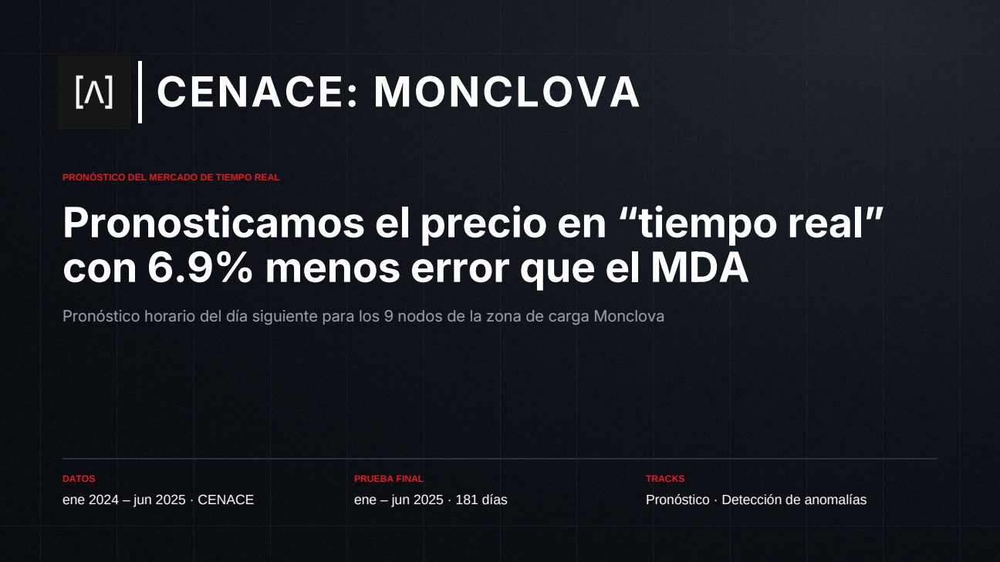</a></td><td><a href="docs/slides/02.jpg">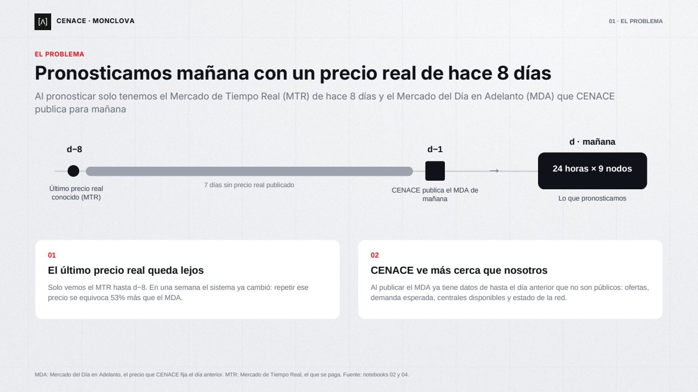</a></td><td><a href="docs/slides/03.jpg">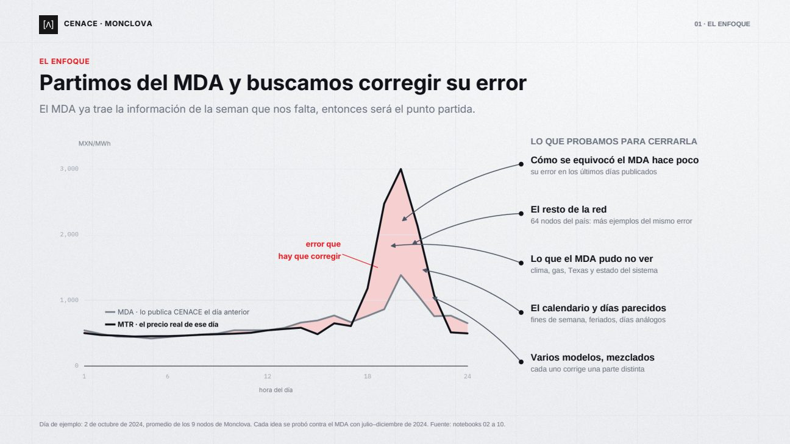</a></td></tr>
<tr><td><a href="docs/slides/04.jpg">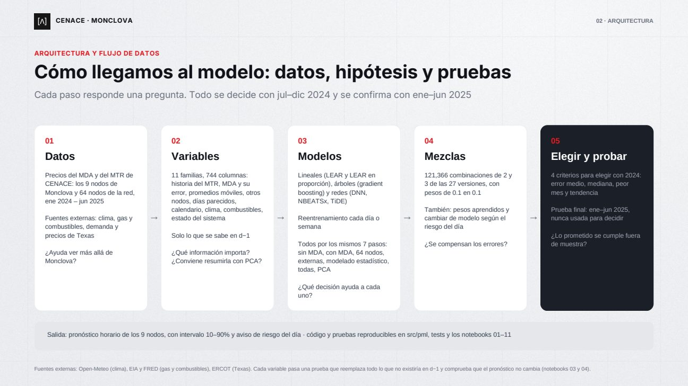</a></td><td><a href="docs/slides/05.jpg">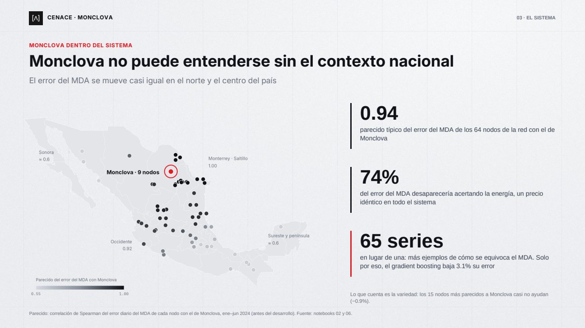</a></td><td><a href="docs/slides/06.jpg">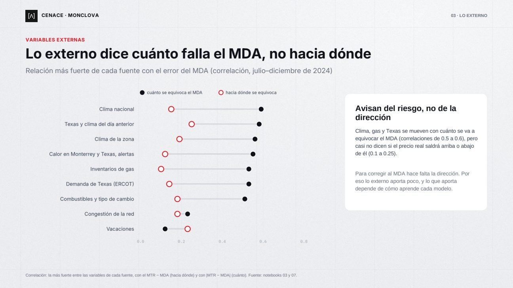</a></td></tr>
<tr><td><a href="docs/slides/07.jpg">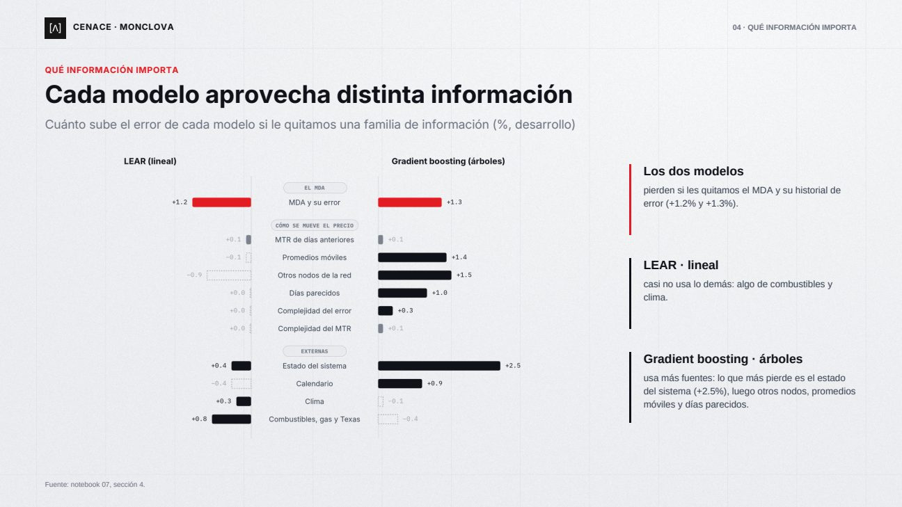</a></td><td><a href="docs/slides/08.jpg">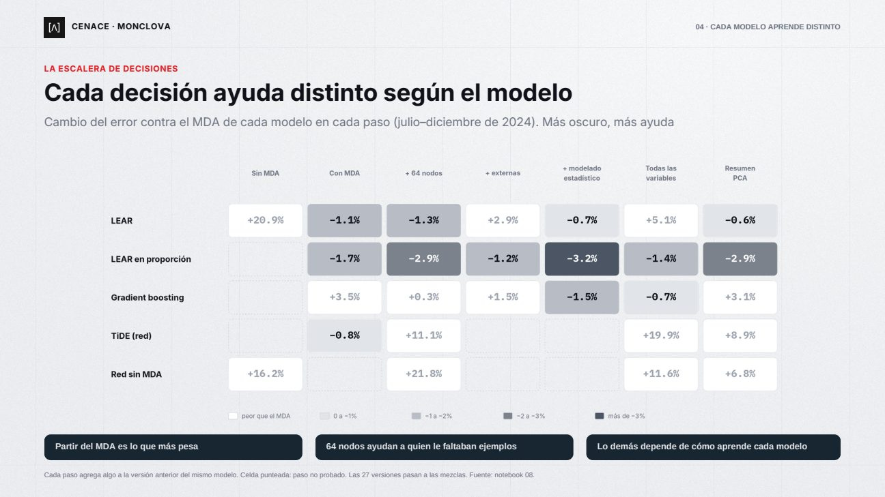</a></td><td><a href="docs/slides/09.jpg">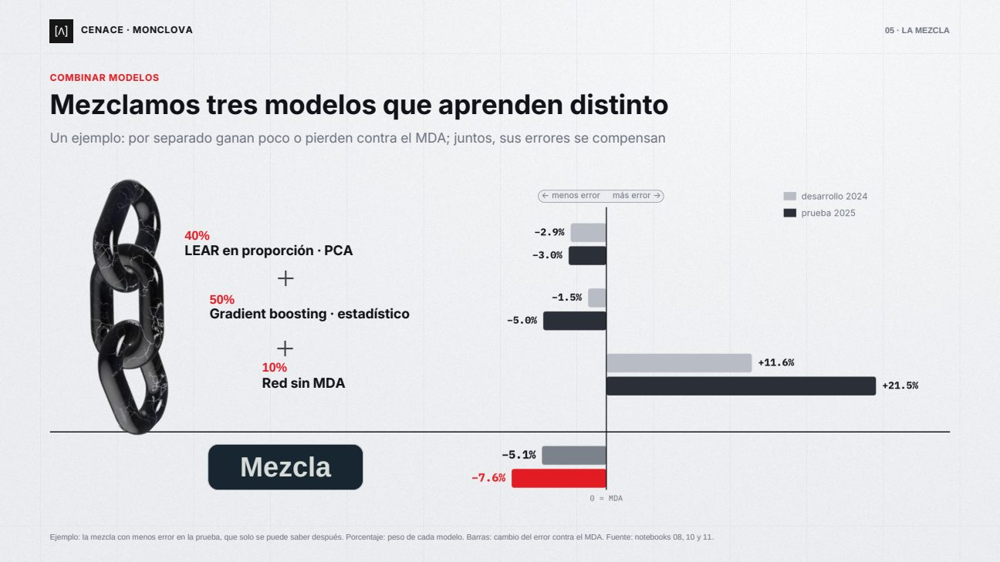</a></td></tr>
<tr><td><a href="docs/slides/10.jpg">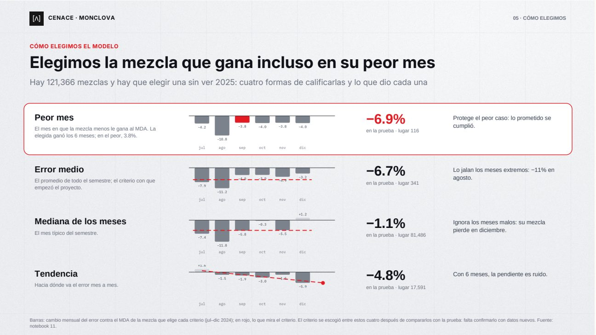</a></td><td><a href="docs/slides/11.jpg">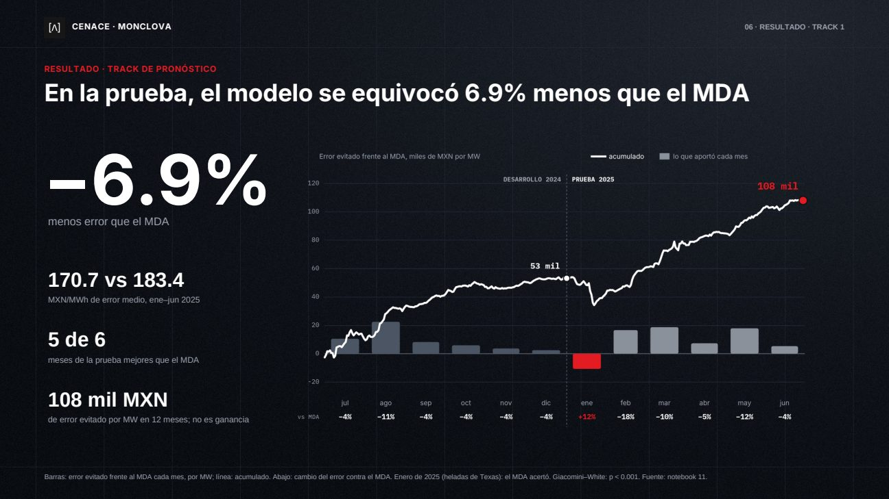</a></td><td><a href="docs/slides/12.jpg">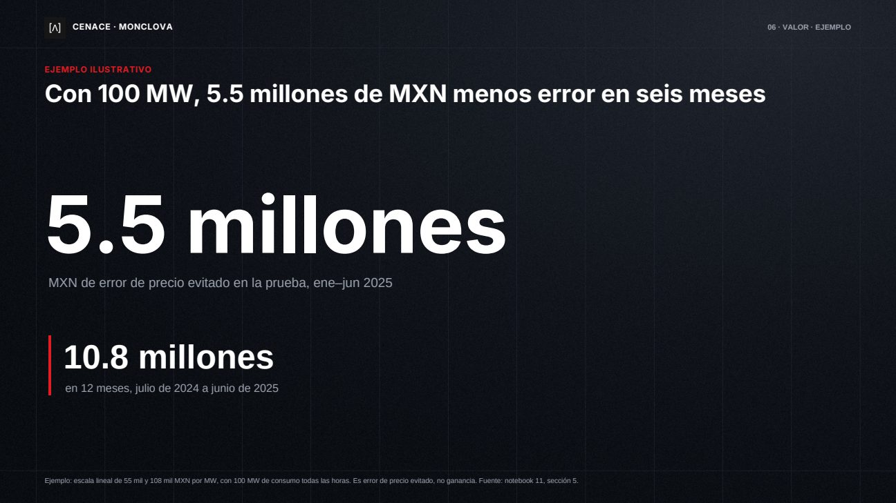</a></td></tr>
<tr><td><a href="docs/slides/13.jpg">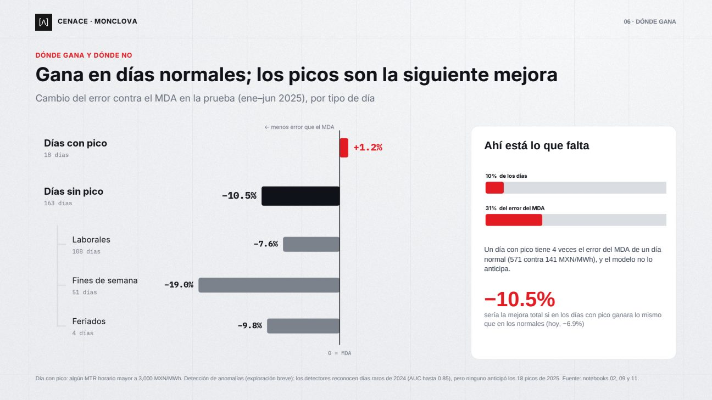</a></td><td><a href="docs/slides/14.jpg">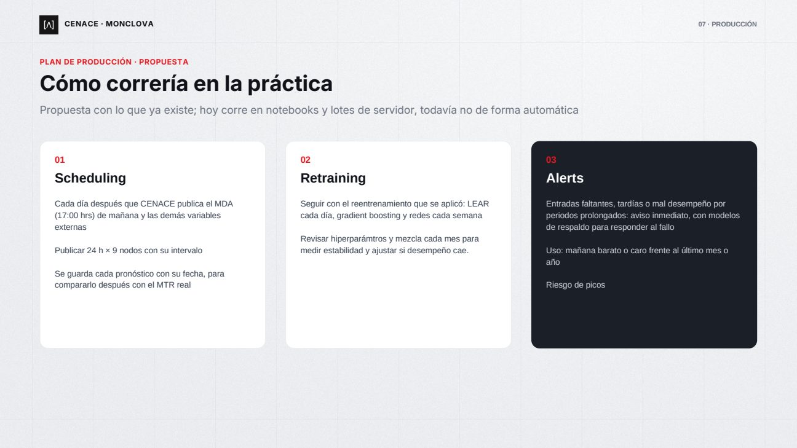</a></td><td><a href="docs/slides/15.jpg">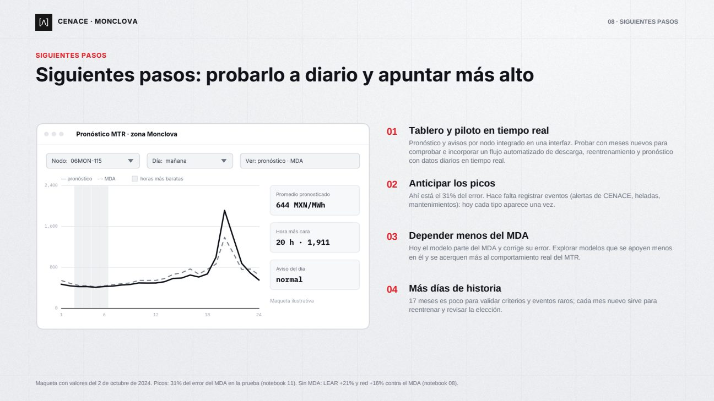</a></td></tr>
</table>

[Descargar el PDF](Executive%20slide%20deck.pdf)

## El problema

Cada día *d−1* se pronostica el MTR del día *d*. En ese momento se conoce el MDA de *d*, pero el último MTR publicado es el de *d−8*. Los datos van del 1 de enero de 2024 al 30 de junio de 2025.

## Resultado en la prueba (enero–junio de 2025, 181 días)

| | Error medio (MXN/MWh) | Contra el MDA |
|---|---|---|
| MDA | 183.4 | referencia |
| **Modelo final** | **170.7** | **−6.9%** (*p* < 0.001; mejor en 5 de 6 meses) |

El modelo final es una mezcla de tres modelos: 0.5·LEAR en proporción + 0.4·gradient boosting con todas las variables + 0.1·red sin MDA. Se eligió entre 121,366 mezclas con el peor mes de desarrollo (julio a diciembre de 2024); el criterio se escogió entre cuatro después de compararlos con la prueba.

## Cómo se hizo

1. **Se parte del MDA y se corrige su error.** Los modelos que lo ignoran quedan 16% a 21% peor.
2. **Más ejemplos con la red de 64 nodos** mejoran al gradient boosting 3.1%.
3. **Cada modelo aprovecha distinto la información**, y las variables externas aportan poco.
4. **Se mezclan modelos que aprenden distinto** y se elige con el peor mes de desarrollo.
5. **Reentrenamiento:** en la evaluación, LEAR se reentrena cada día y el gradient boosting y las redes cada semana, siempre con datos hasta *d−8*. Las variables, los hiperparámetros y los pesos de la mezcla quedan fijos durante la prueba.

## Límites

- El −6.9% es optimista: el criterio de elección se comparó con la prueba y la mezcla se escogió entre muchas candidatas con solo seis meses de desarrollo.
- Gana en días normales (−10.5%), pero no en los días con pico (+1.2%), que son 10% de los días y 31% del error. Perdió en enero de 2025.
- Hay 17 meses de datos y ninguna corrida en producción: todo es un backtest.

## Contenido

| Carpeta | Qué hay |
|---|---|
| `notebooks/` | Once notebooks en orden, cada uno con su pregunta y su conclusión |
| `src/pml/` | Código del pipeline (descarga, variables, modelos, mezclas, métricas) |
| `reports/` | Tablas y figuras de cada notebook |
| `tests/` | Pruebas del código y de no fuga de información |
| `docs/` | Imágenes de las diapositivas y [`detalles.md`](docs/detalles.md), la versión extendida de este README |

| Notebook | Pregunta |
|---|---|
| 01–04 | ¿Son correctos los datos? ¿Dónde falla el MDA? ¿Qué información externa existe? ¿Cómo se mide? |
| 05–07 | ¿Cuánto aporta el MDA? ¿Ayudan más nodos? ¿Qué información importa? |
| 08 | La escalera: cada decisión en cada modelo |
| 09 | ¿Se puede reconocer el riesgo del día? |
| 10 | Mezclas de modelos y elección del modelo final |
| 11 | Evaluación final en la prueba |

## Reproducir

```bash
pip install -r requirements.txt
python src/pml/download_all.py        # descarga de CENACE a data/raw/
cd notebooks && jupyter nbconvert --to notebook --execute --inplace 01_extraccion.ipynb   # y así hasta el 11
python -m pytest tests
```

Las llaves de EIA y FRED van en un archivo `.env` (`EIA_API_KEY`, `FRED_API_KEY`) que no se versiona. Los datos y cachés (`data/raw/`, `data/processed/`) no están en el repositorio. Los notebooks 05 a 08 tardan muchas horas sin esas cachés, y los experimentos pesados se corrieron en un servidor PBS (`src/pml/servidor.py`).

## Desarrollo

Este proyecto fue desarrollado con ayuda de Claude Code.
